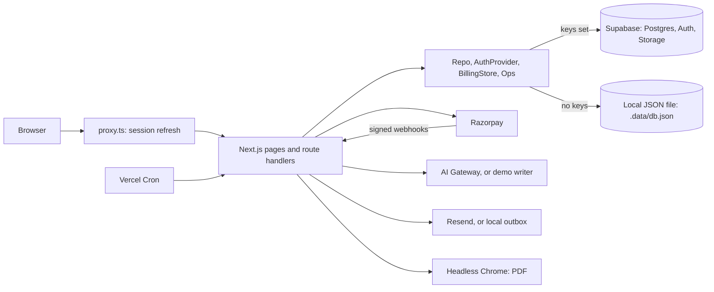

# AI Resume Builder

A resume builder that helps people tailor a resume to a specific job, without inventing anything about them. You set up a profile once, paste a job ad, and get a resume with a live score, the ad's keywords, AI writing help and a real PDF.

"Resume Builder" is a placeholder name until the product is branded. The app isn't deployed yet: it runs locally, against a real Supabase project and Razorpay in test mode.

## Features

- **Saved profile:** enter your details once, or upload a PDF or Word resume to fill them in. Every new resume starts as a copy, so you only add the job.
- **Resume editor:** contact, experience, education, skills, summary and optional sections, with autosave and a live preview.
- **Job targeting:** picks out an ad's keywords, shows which are missing, and drafts a bullet for each one you've really done.
- **Live score:** five categories, with feedback linked to the entry it's about. The job-match score and the keyword panel share one matcher, so they can't disagree.
- **AI writing with no invented facts:** any number the model adds that isn't in your own text becomes a `[number]` placeholder, and the download warns if any are left.
- **PDF export:** the same HTML as the preview, with selectable text. Downloading an unchanged resume again is free.
- **Plans:** Free, Pro (monthly or every 3 months) and Lifetime through Razorpay, with limits enforced in the database and one-click cancel.
- **Accounts:** email and password with confirmation, password reset, change email, sign out everywhere, and full account deletion. Google and Apple sign-in appear once configured.

## Status

| Area | State |
| --- | --- |
| Database, access rules, log-in | Working on the real Supabase project |
| Sign-up and reset emails on Supabase | Built and tested on the local outbox; not yet checked with a real inbox |
| Razorpay checkout | Works in test mode, confirmed with a test payment |
| Razorpay webhooks and cancel | Tested with signed test events only; webhooks need a public URL |
| AI writing | Built; no key set yet, so the deterministic demo writer runs |
| Email from your own domain | Built; needs Resend and a domain |
| Google and Apple sign-in | Built; need your OAuth clients |
| Word download, folders, version history, cover letters, job tracker | Not built |
| Deployment | Not done. PDF export also needs `@sparticuz/chromium` on Vercel |

The full list is in [`replica/features.csv`](replica/features.csv), and open checks are at the end of [`replica/bugs.md`](replica/bugs.md).

## Architecture

One Next.js app holds the marketing pages, the product and the API. Screens and routes only talk to four interfaces, and the environment decides what's behind them, so the app runs with no keys at all.



| Layer | Choice |
| --- | --- |
| App | Next.js 16 (App Router, Turbopack), React 19, TypeScript |
| Styling | Tailwind CSS 4 with design tokens, Radix primitives, Lucide icons |
| Validation | zod, in the browser and on the server |
| Data and auth | Supabase: Postgres with row level security, Auth |
| Payments | Razorpay: Subscriptions, Orders, Checkout, webhooks |
| AI | AI SDK through the Vercel AI Gateway: Haiku 4.5 inline, Sonnet 5.5 for the rest |
| PDF | HTML printed by headless Chrome through `puppeteer-core` |
| Import | `unpdf` and `mammoth`, then the AI or a rule-based parser |
| Email | Resend, also as Supabase's SMTP |
| Jobs | Vercel Cron, with retries and a dead-letter log |

### How the main parts work

- **Switching services:** `src/server/config.ts` reads the environment, and `src/server/repo/index.ts` picks Supabase or the local stand-in. The stand-in follows the same rules (quotas, plan sync, sessions), so tests on it mean something.
- **Resume document:** each resume is one typed JSON document, validated by the zod schema in `src/lib/resume/schema.ts`. The profile has the same shape, so the section forms, the AI writer and autosave work on both.
- **Autosave:** edits are debounced, and every save carries a revision number. A stale tab gets a 409 and is told, so nothing is overwritten. Edits that can't be saved are kept in `localStorage` until they can.
- **Access rules:**
  - User actions run on the signed-in user's Supabase client, so row level security applies to every query.
  - The service role is used only for verified payments, webhooks, cron jobs, refunds, AI logs, the print page and account deletion.
  - The browser never talks to Supabase directly, which lets the session cookies be httpOnly.
- **Quotas:** plan limits live in the database. `consume_quota()` spends one unit in a single conditional update, so parallel requests can't both take the last one. The plan is always recomputed from a user's subscriptions by `sync_plan()`.
- **Payments:** Checkout's result is signature-checked on the server and the plan switches on at once. Webhooks then handle renewals, failed payments, cancellations and refunds; each event is applied once, and subscriptions are re-fetched so out-of-order events can't store stale state. A daily job re-reads open subscriptions to catch anything missed.
- **PDF:** the export route signs a 60-second token and headless Chrome loads `/print/[id]` with it, since that page has no session.
- **Import:** uploads are checked by their first bytes, read in memory and never stored.

More detail is in [`replica/architecture.md`](replica/architecture.md) and [`replica/backend.md`](replica/backend.md).

## Getting started

You need Node 22 or newer, and Chrome for PDF export and the browser tests.

```bash
npm install
npm run seed
npm run dev
```

Open http://localhost:3000. With no `.env.local`, everything runs locally:

- data goes to `.data/db.json`;
- emails, including sign-up confirmation links, go to `.data/outbox.jsonl`;
- the AI is a demo writer;
- payments are off.

The demo login is in [`scripts/seed.mjs`](scripts/seed.mjs).

### Connecting real services

Copy `.env.example` to `.env.local` and fill in what you need. Each service switches on when its keys are present. Step-by-step setup is in [`replica/backend.md`](replica/backend.md).

| Service | Variables | Also needed |
| --- | --- | --- |
| Supabase | `NEXT_PUBLIC_SUPABASE_URL`, `NEXT_PUBLIC_SUPABASE_ANON_KEY`, `SUPABASE_SERVICE_ROLE_KEY`, `DATABASE_URL` | Run `npm run db:migrate`, then `npm run check:supabase`. Set the site URL and paste the [email templates](supabase/templates/README.md) |
| Razorpay | `RAZORPAY_API_KEY`, `RAZORPAY_SECRET_KEY`, `RAZORPAY_PLAN_MONTH`, `RAZORPAY_PLAN_QUARTER`, `RAZORPAY_LIFETIME_AMOUNT`, `RAZORPAY_WEBHOOK_SECRET` | Plans in the dashboard, and a webhook once there's a public URL |
| AI | `AI_GATEWAY_API_KEY` | Credit on the gateway |
| Email | `RESEND_API_KEY`, `EMAIL_FROM` | A verified domain, and Resend's SMTP details in Supabase |
| Google or Apple | `AUTH_OAUTH_PROVIDERS` | OAuth client in Supabase → Providers |
| Secrets | `PRINT_TOKEN_SECRET`, `CRON_SECRET` | `openssl rand -hex 32` for each; required in production |

For `DATABASE_URL`, use the **Session pooler** string: Supabase's direct host is IPv6-only on most plans.

## Testing

```bash
npm run lint
npm test
npm run test:schema
npm run audit:prod
```

| Command | Covers |
| --- | --- |
| `npm test` | Unit tests: the fact guard, Razorpay events and signatures, the import parser, sign-up email failure |
| `npm run test:schema` | Every migration on an in-memory Postgres: access rules between users, quotas, billing, jobs |
| `npm run e2e` | Playwright, one spec per user flow, failing on console errors and 5xx responses, with accessibility scans |
| `npm run walkthrough` | A scripted tour that also saves screenshots to `replica/clone-screens/` |
| `npm run e2e:live` | Log in, edit, PDF and profile import on the real Supabase project |
| `npm run check:supabase` | Access rules over the real API, with two throwaway users |

`npm run e2e` and `npm run walkthrough` read emails from the local outbox, so the dev server must run on the local stand-ins. This ignores any keys in `.env.local`:

```bash
DATA_BACKEND=local NEXT_PUBLIC_APP_URL= RAZORPAY_API_KEY= RAZORPAY_SECRET_KEY= RAZORPAY_WEBHOOK_SECRET=local_razorpay_webhook_check_only npm run dev
```

Restart that server between full runs: local rate limits live in memory, and one run signs up dozens of accounts from one address.

## Project layout

```text
src/
  app/
    (marketing)/       landing, pricing, templates, privacy
    (auth)/            sign up, log in, password reset
    app/               the product: dashboard, profile, settings, resume editor
    api/               route handlers
    auth/              email links and OAuth callbacks
    print/[id]/        the page headless Chrome turns into a PDF
  components/
    ui/                design system components
    editor/            section forms, autosave, finish page
    resume/            the resume document itself
    app/               dashboard, profile, billing, dialogs
  lib/                 code shared with the browser: schema, score, AI guard, import parser
  server/              server-only code
    repo/              data layer: interfaces, Supabase, local stand-in
    auth/              sign-in: interface, Supabase
    billing/           Razorpay client and webhook logic
    ai/                AI writer, credits, job-ad keywords
  styles/              generated design tokens and Tailwind theme
  proxy.ts             session refresh and /app redirect
supabase/
  migrations/          numbered SQL migrations
  templates/           auth email templates
  schema.test.mjs      database rules tests
e2e/                   Playwright specs and fixtures
scripts/               seed, migrate, Supabase check, walkthrough, fixtures
replica/               research, plans, design system, test plan, bug log
```

## Project documents

| Document | What's in it |
| --- | --- |
| [`replica/recon.md`](replica/recon.md) | Research on the product this was modelled on: screens, flows, data model |
| [`replica/features.csv`](replica/features.csv) | Every feature, its priority and whether it's built |
| [`replica/architecture.md`](replica/architecture.md) | The original plan: stack, schema, API, build order |
| [`replica/backend.md`](replica/backend.md) | Current backend: setup checklist, auth, payments, jobs, security checklist |
| [`replica/design/`](replica/design/) | Design tokens and component specs |
| [`replica/test-plan.md`](replica/test-plan.md) | Every test case and its result |
| [`replica/bugs.md`](replica/bugs.md) | Bugs found, how each was fixed, and what's still to check |
| [`replica/build-log.md`](replica/build-log.md) | Screen-by-screen build notes |

The code, copy and design here are original; the research informed what to build, not how it looks or reads.
